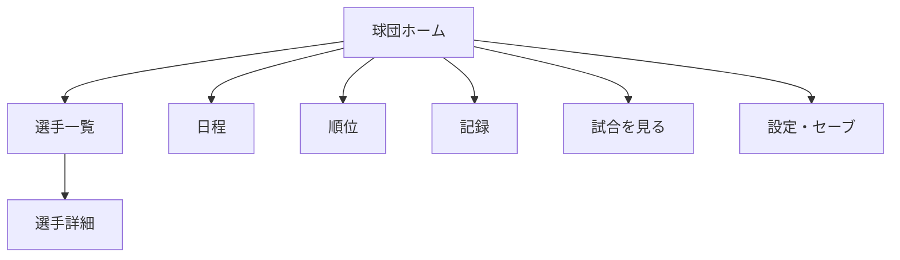

# 球団ホーム・選手一覧/詳細をつなぐ設計案

2026-11-17。**Accepted / D060 CONFIRMED（限定UI）。設計PRは文書のみ、実装へ進む。** 基準mainは `edc803ed16a57339e4b87330ae0c83fe86900756`（[PR #47](https://github.com/thrsth45h/baseball-sim/pull/47)）。[Pennant Spiritsを主基準とする完成像](PENNANT_SPIRITS_BASELINE.md)の段階Aを具体化する。[ADR-0018](adr/0018-club-home-player-browser.md)も参照。

当初の「続けて」は具体設計の指示だった。その後、[設計PR #48](https://github.com/thrsth45h/baseball-sim/pull/48)と、起動後ホーム優先/旧1試合保持、固定108人の一覧/詳細、日程/順位/記録/観戦/保存への移動、閲覧で操作球団や進行を変えない範囲を提示し、本人が「はい」と回答した。既存のworker委任・継続的マージ許可に基づき、設計統合→worker実装/CI/APK→責任者独立レビュー/必要修正→問題のないPR統合まで進める。内部の全技術細目を本人が個別精査したとは記録せず、以下の限定UIと既存契約維持を採用範囲とする。

## 目標と範囲

今の単一ペナント画面を、球団ホームから選手・日程・成績・観戦へ行き来できる構成へ整理する。既存の12球団/固定108人/単年度/限定5件数を使い、選手を見る操作と試合を進める操作を分ける。

追加する主な機能はホームと選手一覧/詳細、既存画面への移動である。編成変更、控え/投手ローテ、選手能力/名前/年齢/位置の新データ、公式打率等、新年度、契約/経営、CPU采配は別の設計とする。仮の値や動かないメニューで完成機能を装わない。

参照作品の[メイン画面](https://pennantspirits.ifdef.jp/manual_g_1.html)・[選手データ](https://pennantspirits.ifdef.jp/manual_6.html)・[選手リスト](https://pennantspirits.ifdef.jp/manual_g_10.html)を機能の参考にし、PCのタブ数や操作をそのまま移さない。

## 画面と入口

保存された画面情報がない新規起動では「ペナント」を初期モードとする案。既存の「1試合」モードは切替から利用でき、復元されたモード選択は尊重する。単独試合のルール/操作/乱数を変えない。

ペナントに入った時はホームを基本とし、有効な同一セーブのUI復元情報があれば後述の条件で利用する。シーズン未作成時はホーム内に既存のseed・開始球団・新シーズン開始を表示し、まだ存在しない選手/日程への入口は出さない。

| 画面 | 表示と操作 |
|---|---|
| ホーム | 操作球団名、仮日程の現在位置、完了試合数、当該球団の順位/勝敗。選手/日程/順位/記録/設定への入口と、既存の1日/シーズン進行 |
| 選手一覧 | 閲覧球団を12球団から選択し、その固定9人を打順順で表示。既存IDと打順で識別し、行から詳細へ。検索/並替え/編集は今回は追加しない |
| 選手詳細 | 選手ID、所属球団、固定打順、当季の完了打席・セーフ安打・四球・三振・本塁打。未整備の人名/年齢/能力/守備位置を埋めない |
| 日程 | 既存の週/曜日・前日/翌日の閲覧・対戦/結果。現状のday番号を実暦の日付にしない |
| 順位 | 既存のリーグ切替と順位/勝敗/得失点/勝率。順位規則や分母は変更しない |
| 記録 | 既存の球団別5件数の表を保持。選手一覧/詳細と同じ確定値を表示する |
| 試合 | 既存の進行中または直近完了試合の表示、1球/1打席/最後まで、結果と直近プレー。未完了停止時のGameId/理由も保持 |
| 設定・セーブ | 既存の新seed/新シーズン、操作球団の変更、試合外save/loadと確認。新しい設定項目やセーブ枠は増やさない |

ホームの順位等は `season.selectedClubId` の球団を対象とする。進行中の試合が別球団同士でも、その試合カードに実際の両球団を表示し、操作球団の試合と誤表示しない。

「試合を見る」は既に公開されている進行中/直近試合へ表示を移すだけ。表示対象がない時は出さない。別に、既存 `OPEN_SELECTED` を使うボタンを「自球団戦へ進む」と表現し、他球団の試合等を進める操作だと分かるようにする。これを押した時に試合画面へ表示を移し、完了callbackを画面移動や再送の起点にしない。進行受付の競合/エラーは従来のViewModelが扱う。画面移動そのものによる追加進行はない。

試合終了後にホームへ戻っても次の試合は始めない。日程の前日/翌日閲覧と「1日進める」も、別の操作として保持する。

## 閲覧データの契約

根拠は [固定ロスター](../android/core/src/main/kotlin/com/example/baseballsim/season/Schedule.kt)・[集計](../android/core/src/main/kotlin/com/example/baseballsim/season/Records.kt)・[公開状態](../android/app/src/main/java/com/example/baseballsim/PennantViewModel.kt)。

- 一覧の母集団は `PennantSchedule.clubs/players` の12×9人。IDは108人で一意であり、打順は背番号/守備位置ではない。
- 記録は最新の公開済み `SeasonState.playerCounts` をplayerIdと所属で結ぶ。0試合時も固定全員の0件を表示する。シード入力欄や表示用の閲覧球団から別世界の値を作らない。
- この集計は確定した完了試合だけを含む。進行中試合の一時的な打席結果を年次集計へ足さない。「確定試合の記録」と分かる短い説明を置く。
- セーフ安打に本塁打を含む既存の定義を維持し、その意味を必要な箇所で示す。正式打数/打率/投手成績を限定件数から捏造しない。
- 表示時にエンジンを作成/再生せず、既にViewModelが公開した値を使う。状態が更新されたら同じ選手の最新件数へ追従し、詳細を開くたびにDBを読み直さない。
- 操作球団は既存の保存対象 `selectedClubId`、閲覧球団/選手はUIだけの値。選手一覧や記録の球団切替で `SELECT` その他の保存/進行commandを呼ばない。操作球団の明示変更は設定画面の既存機能で行う。

## 戻る・選択保持・保存世代

画面移動と選手閲覧は純粋なUI状態の変更とする。これを理由に `PennantActions.read/execute/hasSlot`、`reload`、`pennantDisplay` の再生成、保存、試合のadvanceを呼ばない。通常起動/明示再読/既存command後の公開処理は従来どおりであり、既存readによるdurable checkpointの復旧を新ナビゲーションへ移さない。

| 場面 | UI状態の扱い |
|---|---|
| ホームから選手一覧/記録へ新しく入る | 閲覧球団は現在の操作球団を初期値とする。選手一覧は先頭から |
| 一覧→詳細→戻る | 同じ閲覧球団、一覧位置を保持。Androidの戻る/画面の戻るは同じ遷移 |
| 日程/順位/記録/試合/設定/一覧から戻る | ホームへ。日程閲覧位置等の保持は同じセーブ内に限る |
| ホームからAndroidの戻る | 既存の最上位動作へ委譲。保存/進行のための独自commandを追加しない |
| 回転 | 同じViewModel/処理を維持し、画面・閲覧球団・選手・スクロール位置を復元する |
| 同world/generationのrevision更新 | 画面/選手の選択を維持し、公開済み最新値へ追従する |
| 新シーズン作成/手動loadでworldまたはgenerationが変わる | ホームへ戻り、閲覧球団は新しい操作球団、選手/一覧位置/確認ダイアログは解除する |
| 起動直後の読込中 | UI復元候補をまだ採用/破棄せず、保存されたidentityの確定を待つ |
| 読込完了でセーブなし | 開始ホームへ。古い選手や世代の表示は採用しない |
| 復元された球団/選手/組合せが無効 | 安全にホームと現在の操作球団へ戻す。DBへ補正値を書き込まない |

UI復元情報にはページ/閲覧球団/選手だけでなく、結び付く **worldIdとgenerationId** を含めて検証する。同seed・同選手IDでも新しいworld/generationなら古い選択を採用しない。revisionはこのidentityに含めず、進行による通常更新で画面を閉じない。選手IDが存在しても閲覧球団との組合せが異なる復元値は受理しない。

UI選択はRoom/schema/セーブframeへ追加しない。既存Composeの保存可能なUI状態等を利用できるが、OSから復元情報が提供される場合だけ復元する。提供されないcold start/force-stop後はホームでよい。最後に見た選手画面の永久保持を保証する機能ではない。

## 進行中・停止・エラー

共通の状態表示はページ切替で消さない。bulk中はどのペナント画面でも停止予約へアクセスでき、閲覧や戻るだけで停止/再開commandを送らない。表示先のComposeの生成/破棄や選択変更で、処理を所有するViewModelを作り直さない。完了callbackは現在の公開値を更新するだけで、ユーザーが選んだ画面を後から奪わない。

進行/新規/save/load/操作球団変更の可否、連打の同期拒否、試合外だけの手動save/load、未完了停止は既存 `PennantUiState` の条件を維持する。新規/loadの既存確認ダイアログが開いている場合、戻るはまずダイアログを閉じ、背後の画面操作へ通さない。確認は表示時の**公開済みStoreToken**（world/generation/revision）へ結び付け、command受付時の公開tokenと異なる古い確認イベントは実行せず破棄する。画面選択を保持するためのworld/generationだけの検証とは区別する。

この比較はViewModelが公開した状態同士の照合であり、UIへ未公開の外部writerによるDB変更まで検出する新保証ではない。確認時にDBを読む処理やexpectedToken付きの新しいcommand契約は追加しない。保存の競合は既存Coordinator/Storeの実行時読取・CAS・応答照合の範囲で扱い、その契約の拡張は別設計とする。

保存読込エラーで前の公開値が残る場合は、その値の閲覧だけを許可し、共通のエラー表示と明示再読を残す。進行・置換等は従来の条件で無効のまま。BLOCKED時はGameId/理由と停止状態をホーム/試合から確認でき、別画面へ移動しても復旧扱いにしない。未確認データを上書きする新規開始や、自動的なDB修復/削除を追加しない。

## 技術・表示の境界

Kotlin/Compose、Activity単位の既存ViewModel、`PennantActions` からの確定値公開を維持する。新しいナビゲーション/DI依存、ネットワーク権限、background service、DB migrationを必要条件にしない。UI状態/純粋な表示用projectionの追加と既存画面の分割を基本とし、必要な小さなViewModel調整は画面状態の管理に限定する。

core/season、RNG、toy確率、日程、記録の裁定、`SeasonCoordinator/RoomSeasonStore`、codec/schema、保存成功後公開の契約は変更しない。公開値を閲覧するために保存回数や再検査方式を変えない。研究成果の本番統合は含めない。

狭幅320dpで入口/一覧/詳細/戻る/停止へ到達できる縦配置を基本とする。既存の横長順位/記録表は横スクロールを保持する。文字拡大1.5倍でも主要なボタン/ID/数値が読めることを確認し、不要な補助説明や未実装のダミーメニューを増やさない。選手行はタップ対象と識別内容がアクセシビリティ情報からも分かるようにする。

## 受入条件と検証案

以下は実装後に行う検証で、今回は実行済みの主張ではない。

1. **起動/移動**：UI復元情報なしの起動→ペナントの開始/球団ホーム。既存「1試合」へ切替可能。ホームの各入口へ到達し、一覧→詳細→一覧→ホームがAndroid戻るでも一致する。
2. **全員と件数**：12球団それぞれ9人、計108 IDを一覧から詳細へ選択し、所属/打順/全5件数を公開stateと照合。0試合/途中/終了時、最初と最後の球団/選手を含む。最新revisionへ更新しても同選手の値に追従する。
3. **閲覧無作用**：fake Actionsで初期read等の後に呼出しログを固定し、画面移動/球団閲覧/詳細/戻る/回転だけではActionsへの追加呼出し0を確認。実DBはbulk/外部writer/明示commandが動いていない境界で比較し、操作前後のtoken/revision/operation/frame全byte/結果行/slot/receiptが不変、未終了の試合checkpointがあってもsnapshot/RNG/source/advanceが不変。bulk中の正規の更新は不変条件の対象にせず、次の6で余計なcommandがないことを検査する。
4. **操作球団の分離**：他球団の一覧/記録を閲覧しても保存selectedClubIdと「自球団戦へ進む」の対象が変わらない。明示SELECTだけは既存どおり保存される。
5. **世代境界**：同seed/同ロスターの新規world、slot loadで新generation、同contextのrevision更新を区別する。古いroute/選手/スクロール/確認dialogの復元、存在しないIDや所属不一致を入力して検査。読込中に復元候補を早期リセットしない。
6. **進行とUI**：live bulk中に一覧/詳細へ移動し、STOPが使え、停止予約が現試合終了後に効く。移動/回転/連打でcommand二重実行なし。完了callbackで別ページへ強制移動しない。未完了/読込失敗の表示と進行禁止は全ページで維持する。
7. **互換と復旧**：既存単独試合・純Kotlin・保存/故障/競合・全720試合・実force-stop復旧を保持。UI操作列は入口変更に合わせて更新できるが、既存の状態/終了/保存/乱数のassertを削除しない。全720の最終frameは既存の独立期待値と全byte一致させる。
8. **既存セーブ**：変更前のschema1で作った記録済みDBを移行/再作成せず読み、閲覧往復で値が変わらず、その後の次1球/再保存が同じ結果になることを確認。試験用DBをユーザー端末へ導入しない。
9. **実画面と配布**：CIのAPI35隔離emulatorで操作/回転/320dp/文字1.5倍と実PNGを確認。配布APKそのもののforce-stop→同checkpoint→次1球を保持し、hash/source/取得手順を報告。API26は引き続き宣言値、実機は実施した場合だけ検証済みとする。

M1の成果は管理画面の入口であり、編成/能力/オフを遊べる状態の完成ではない。エンジン同一性の根拠と、表示/移動の新しい検証を分けて報告する。速度改善を今回の採用条件にせず、重い再読や表示処理を移動ごとに追加しない。

## 作業順序・未決定事項

責任者/readonly reviewerの設計点検と限定UIの本人承認を記録し、必要な文書チェック後に設計を統合する。そのmainから専用workerへUI実装/意味のある回帰/CI/APKをまとめて委任し、責任者が独立レビュー・修正指示・問題のないPR統合を行う。既存worktree/未保存資料を保持し、ユーザーPCの画面/入力/SDK/IDE等を操作しない。今回の設計段階ではAndroidコードとAPKを変えない。

D060は今回の限定UIだけCONFIRMED。D029/D030/D031/D056、能力・編成・年次・経営等の詳細は未決定として維持する。D059だけから実装承認を導かず、PR #48提示後の本人回答を今回の根拠にする。
